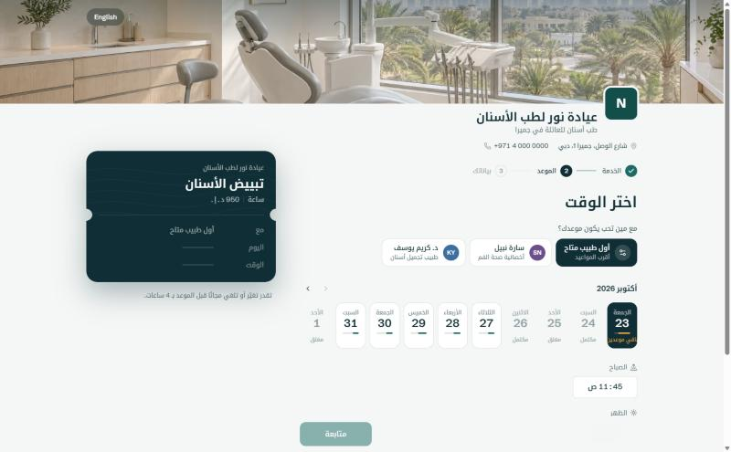
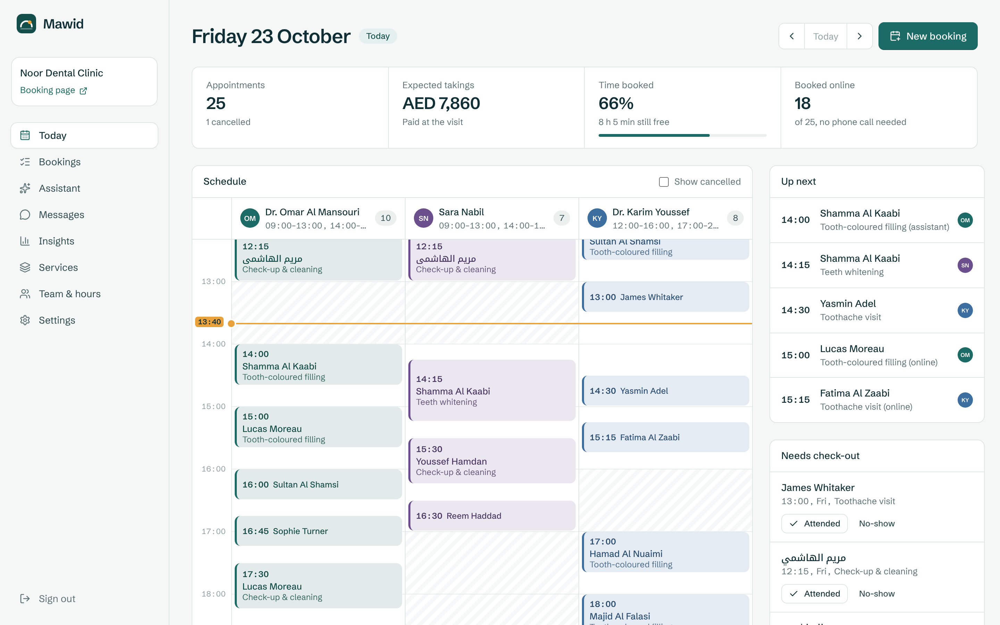
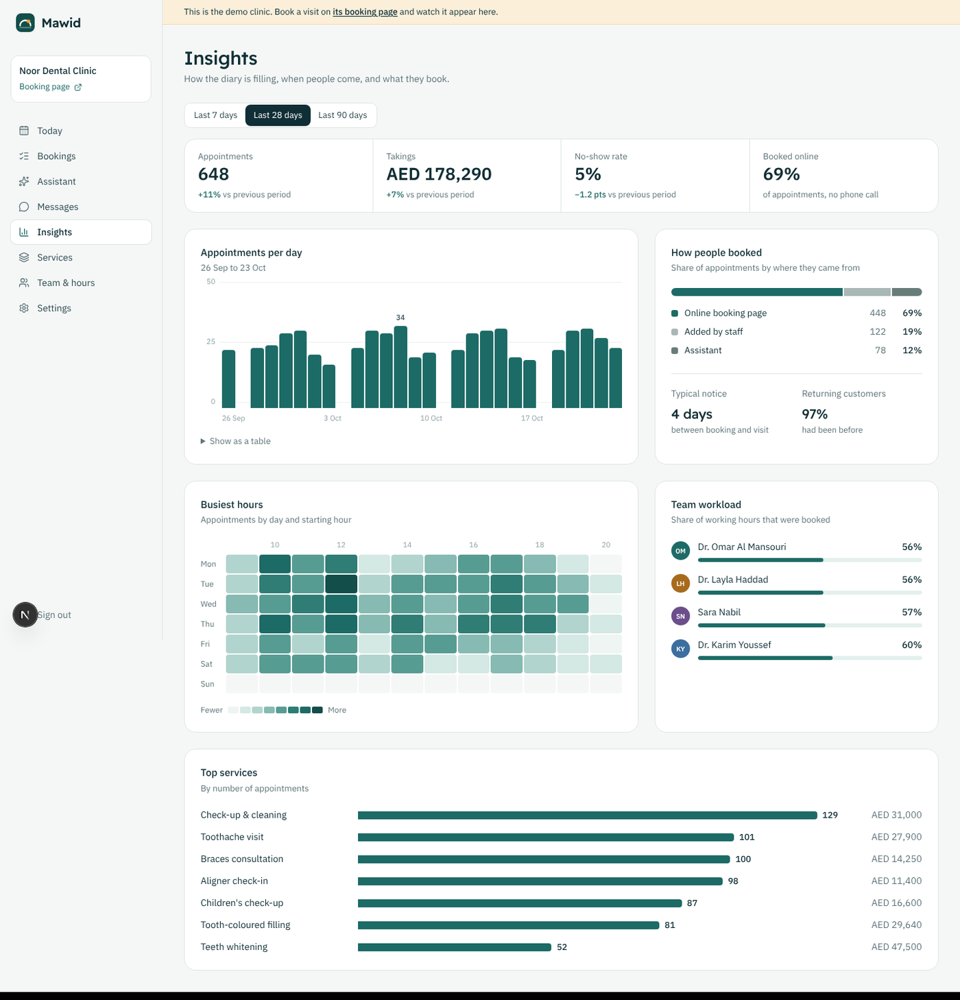
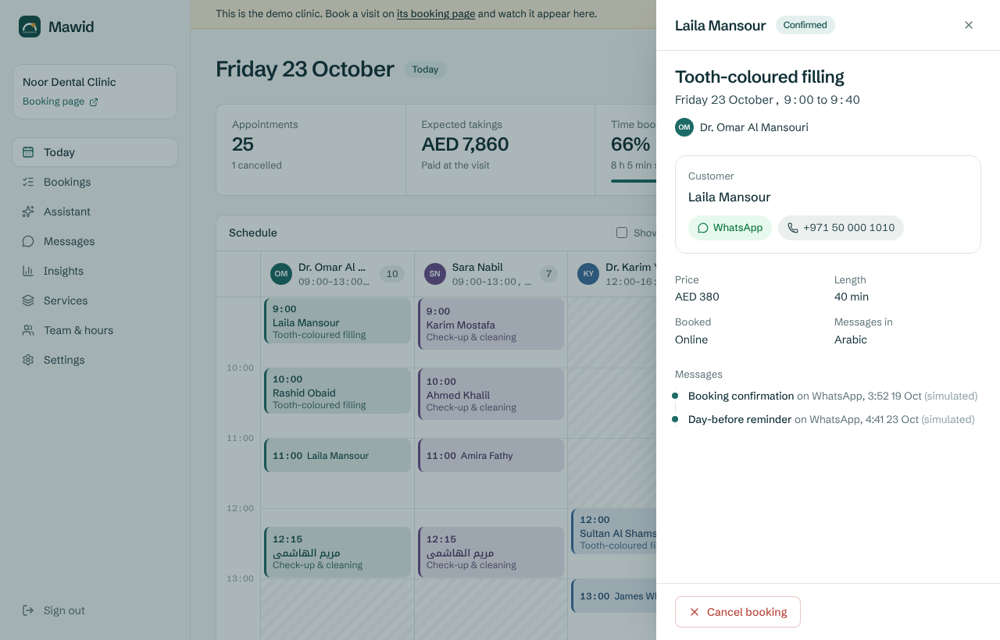

# Mawid (موعد)

Online booking, WhatsApp reminders and a live schedule for clinics, salons and studios in the Gulf. Arabic first, English one tap away.

**Live demo:** https://mawid-bay.vercel.app
Open the demo clinic from the home page (no sign-up), or book a visit as a patient at `/b/noor-dental` and watch it land on the schedule.


## What it does

**For patients** (`/b/[slug]`, Arabic RTL by default)
- Pick a service, a person or "first available", then a real free time. A day strip shows how booked each day is.
- The chosen time is held for a few minutes while they type, with a visible countdown, so nobody else can take it.
- Confirmation on WhatsApp (and email if given), an `.ics` file, a Google Calendar link, and a private link to move or cancel within the clinic's policy.

**For the front desk** (`/dashboard`)
- **Today:** every team member side by side on a timeline with a live now-line, day totals, who is up next and visits waiting to be checked out.
- **Bookings:** search by name or phone, filter, export CSV. Phone and walk-in bookings go through the same checks as online ones.
- **Assistant:** quick answers from the live schedule in English or Arabic ("who's free tomorrow afternoon for a check-up?", "مين عنده مواعيد بكرة الصبح؟"), with the next steps as buttons. It books, moves or cancels, and nothing changes until the owner confirms.
- **Messages:** the outbox of everything sent to patients, in their language.
- **Insights:** appointments per day, busiest hours, no-show rate, where bookings came from, how full each person's week was.
- **Services, Team & hours, Settings:** bilingual services, shifts and breaks, time off, booking rules, the booking link with a QR code.

## Screens

| Booking page (Arabic, RTL) | Today, the front desk |
|---|---|
|  |  |
| **Insights** | **A booking, with its message trail** |
|  |  |

## How it's built

| | |
|---|---|
| App | Next.js 16 (App Router, Cache Components, Server Actions), React 19, TypeScript |
| Data | Postgres with Drizzle ORM. PGlite (Postgres compiled to WASM) for local dev and tests |
| UI | Tailwind CSS 4, Schibsted Grotesk + Noto Kufi Arabic, no component library |
| Assistant | Rule-based intent matching in English and Arabic, replies built from live data. No language model, so it is instant, free to run and predictable |
| Messaging | WhatsApp Cloud API and Resend, both optional; without keys messages are recorded as "simulated" |
| Hosting | Vercel (cron for reminders), any Postgres (Supabase, Neon) |

### Decisions worth reading

**Double bookings are impossible, not unlikely.** Each booking stores the time it occupies (appointment plus cleaning gap). A Postgres exclusion constraint rejects any two active rows for the same staff member whose ranges overlap:

```sql
ALTER TABLE bookings ADD CONSTRAINT bookings_no_overlap
  EXCLUDE USING gist (staff_id WITH =, tstzrange(occupied_from, occupied_to, '[)') WITH &&)
  WHERE (status IN ('held', 'confirmed', 'completed'));
```

The application checks availability first for a good error message, but correctness doesn't depend on it. `test/bookings.test.ts` fires five holds at the same slot concurrently and asserts exactly one wins.

**Holds instead of locks.** Picking a time inserts a `held` row with an expiry. Expired holds are deleted only when someone else needs that time, so a slow patient can still confirm if nobody took it. Going back releases the hold immediately.

**Reminders send once.** A sweep claims each reminder with `UPDATE … WHERE reminder_sent_at IS NULL RETURNING` before sending, so overlapping runs can't message a patient twice. It runs from a daily Vercel cron and, throttled through an `app_jobs` row, after normal traffic, which keeps same-day reminders on time without a paid scheduler.

**Time zones.** Instants are stored in UTC; slot grids, working hours and "today" are computed in the business's IANA zone. Calendar days travel as plain `YYYY-MM-DD` strings so nothing shifts on a server in another zone.

**The availability engine is pure.** `src/lib/availability.ts` takes hours, busy ranges and rules and returns slots. It has no database access, which keeps it fast to test.

**The assistant proposes, the owner decides.** Typed questions go through a pure, tested function (`src/lib/assistant/understand.ts`) that picks out the intent, the day ("بكرة", "next Thursday", "29/10"), the part of the day, the service, the team member, and a customer's name or phone. Each reply is computed from live data and offers the follow-ups as buttons. Booking, moving and cancelling always stop at a confirm card, and the write is a separate step that re-checks the time with the same guarded functions as the booking page, so a stale card can't double-book. Steps coming from the browser are validated with Zod and every query is scoped to the signed-in business. The operations sit behind one interface (`src/server/assistant.ts`), so a language model could later replace the matcher without touching the writes.

## Run it locally

```bash
npm install
npm run dev        # http://localhost:3000
```

No database setup needed: without `DATABASE_URL` the app runs an embedded Postgres in `.data/pglite` and seeds the demo clinic (four months of bookings). Sign in with **Open the demo clinic**, or `demo@mawid.app` / `demo1234`.

```bash
npm test           # unit tests, plus integration tests on a real Postgres engine (PGlite, in memory)
npm run typecheck
npm run lint
```

## Deploy

1. Import the repo on Vercel.
2. Add a Postgres database (Vercel Storage, Supabase or Neon). `DATABASE_URL` or `POSTGRES_URL` is picked up automatically; migrations run during the build with an advisory lock.
3. Set `AUTH_SECRET` (random, 32+ characters) and `CRON_SECRET`.

Optional: `WHATSAPP_TOKEN`, `WHATSAPP_PHONE_NUMBER_ID`, `WHATSAPP_TEMPLATE` for real WhatsApp delivery; `RESEND_API_KEY` and `EMAIL_FROM` for email.

Without a database the deployment still works: it falls back to an embedded Postgres in `/tmp`, seeded with the demo, which resets when the instance does.

## Project layout

```
src/
  app/
    b/[slug]/            public booking page
    m/[token]/           patient's manage link
    dashboard/           the front desk (Today, Bookings, Assistant, ...)
    api/                 booking, availability and cron routes
  components/booking/    day strip, slot grid, ticket, booking flow
  components/dashboard/  timeline, booking sheet, insights charts, ...
  db/                    schema, SQL migrations, demo seed
  lib/                   availability engine, time zones, message templates
  lib/assistant/         reading English and Arabic questions into steps
  server/                bookings, notifications, reminders, assistant replies
test/                    integration tests on PGlite
```

## Credits

Designed and built by [Seif Ashraf](https://seifashraf.dev). Photography and the hero film were generated for this project with Higgsfield.
